<div align="center">


# Bee Good Food

**Excedentes do dia de pequenos negócios de comida, com desconto, para reservar pelo site e retirar no balcão.**

Projeto final do **Programa Transforma Futuros** (Recode Fullstack), evoluído a partir do meu TCC. Alinhado ao **ODS 8**: trabalho decente e crescimento econômico.


### [▶ Abrir a demonstração online](https://bee-good-food-recode.vercel.app)

Entre como **cliente**, **dona de loja** ou **moderação** com um clique, sem cadastro.

</div>

> [!NOTE]
> **Projeto acadêmico, sem fins lucrativos.** O site publicado na Vercel existe apenas para avaliação do TCC e para portfólio. Lojas, ofertas e pedidos são fictícios e ficam só no navegador de quem acessa: nada é vendido, cobrado ou entregue, e nenhum dado pessoal é coletado. A demonstração roda a interface real com uma API simulada no navegador ([DEC-037](docs/planejamento/decisoes-do-mvp.md)); o sistema completo, com a API Java e o MySQL, roda localmente pelos passos de [Como executar](#como-executar-localmente).

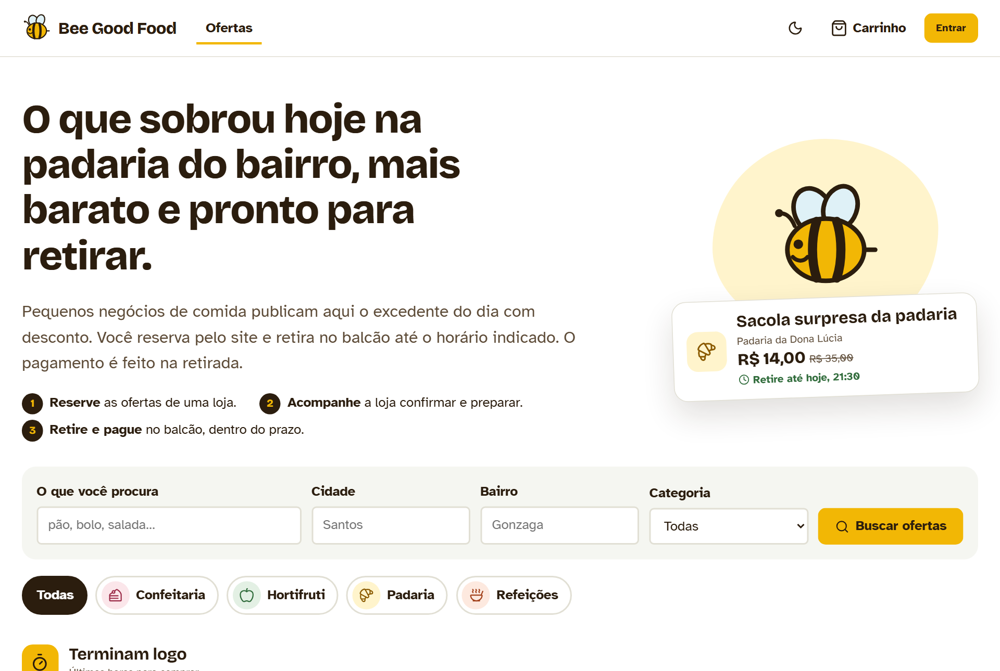

## Sobre o projeto

Padarias, hortifrutis e restaurantes de bairro terminam o dia com produtos bons que não foram vendidos. O Bee Good Food permite que esses negócios publiquem o excedente com desconto. O cliente reserva pelo site e retira na loja dentro de um prazo combinado. O pagamento é feito no balcão: o sistema só registra a forma escolhida.

O foco é o pequeno negócio local. Ele ganha um canal de venda simples, recupera parte do valor de produtos que seriam perdidos e acompanha os resultados em indicadores.

| Para quem | O que a plataforma oferece |
|---|---|
| **Cliente** (18 anos ou mais) | Busca por texto, cidade, bairro e categoria; carrinho de uma loja; reserva; acompanhamento do pedido; histórico. |
| **Responsável pela loja** | Cadastro da loja com moderação; produtos e ofertas com preço, estoque e prazos; fila de pedidos; indicadores de vendas e cancelamentos. |
| **Administração** | Aprovação, pedido de ajustes, suspensão e reativação de lojas, sempre com motivo registrado; categorias. |

| No desafio | No projeto |
|---|---|
| **Problema** | Pequenos negócios de comida perdem o excedente do dia por falta de um canal simples de venda. |
| **ODS** | ODS 8: Trabalho Decente e Crescimento Econômico. |
| **Público-alvo** | Responsáveis por pequenos negócios de comida e consumidores adultos. |
| **Impacto esperado** | Receita extra para a loja e comida mais barata perto de casa. Ainda não medido com pessoas reais. |
| **Tecnologias** | MySQL, API em Java e interface em ReactJS. |
| **CRUDs completos pela interface** | Categorias, produtos e ofertas: criar, listar, atualizar e remover. |

[Como cada exigência do desafio foi atendida](docs/planejamento/atendimento-ao-desafio.md).

## Comparado com o mercado

Antes de fechar a interface, comparei o Bee Good Food com Too Good To Go, Food To Save, Phenix, Karma e Flashfood ([análise completa](docs/planejamento/analise-de-mercado.md)). O que entrou no MVP, sem sair do escopo:

| Ideia do mercado | Como ficou no Bee Good Food |
|---|---|
| Vitrine em seções | Trilhos "Terminam logo" e "Maiores descontos" antes da lista completa |
| Ordenar resultados | Termina antes, maior desconto, menor preço ou mais recentes ([DEC-032](docs/planejamento/decisoes-do-mvp.md)) |
| Comprovante no balcão | Código de retirada (`BG-0042`) em destaque no pedido, verde quando está pronto |
| Impacto para o cliente | "Você já economizou R$ X" em Meus pedidos e economia em cada pedido |
| Sacola surpresa | Selo próprio na vitrine para sacolas com o excedente variado do dia |
| Urgência honesta | "faltam 45 min" quando a venda termina em até 3 horas |
| Uso no celular | Barra de navegação inferior, avisos rápidos e tema escuro |

O que ficou de fora e por quê (favoritos, avaliações, distância, entrega, pagamento no app) está na mesma análise.

## Veja em ação

As telas abaixo usam apenas dados fictícios, criados pelo [script de demonstração](frontend/scripts/popular-demo.mjs).

| | |
|---|---|
| 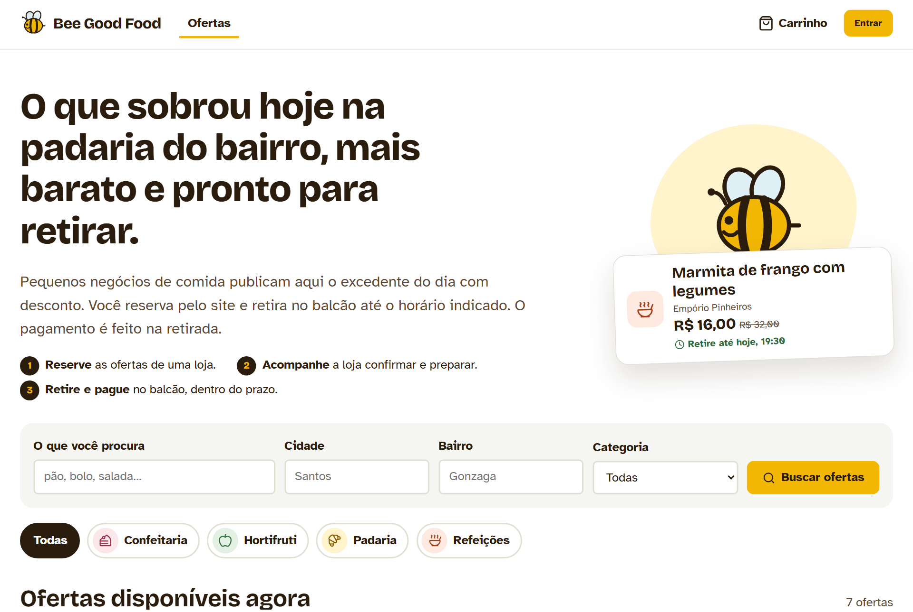 | 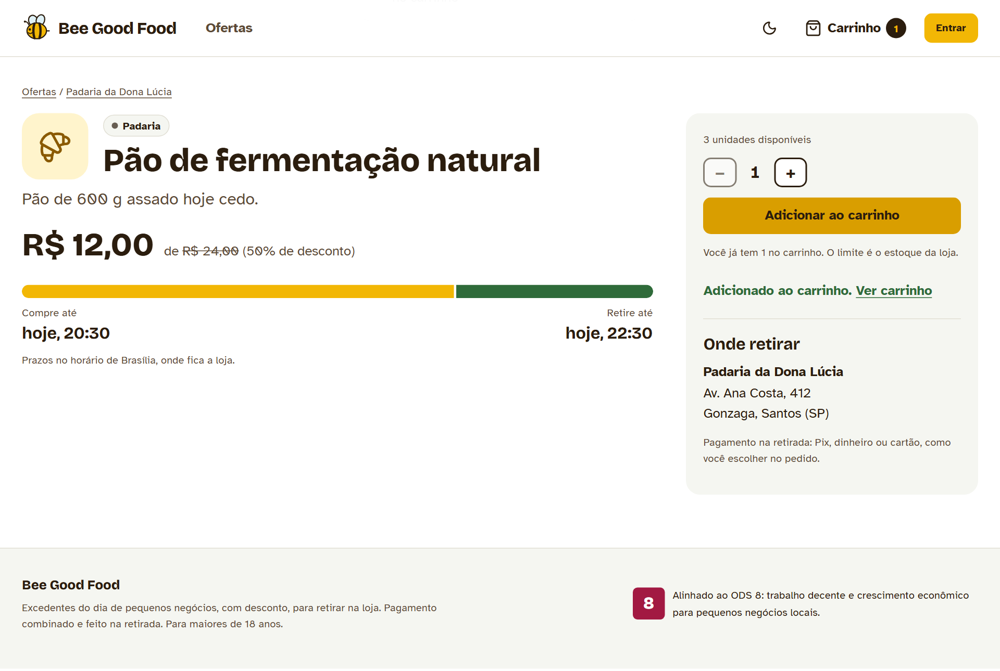 |
| **Vitrine:** seções "Terminam logo" e "Maiores descontos", selo de sacola surpresa e ordenação. Cada cartão mostra o desconto e a faixa de prazo, com "Compre até" e "Retire até" separados. | **Detalhe da oferta:** quantidade limitada ao estoque e endereço de retirada. |
| 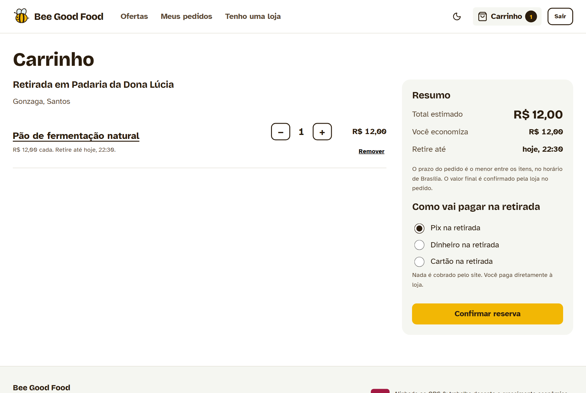 | 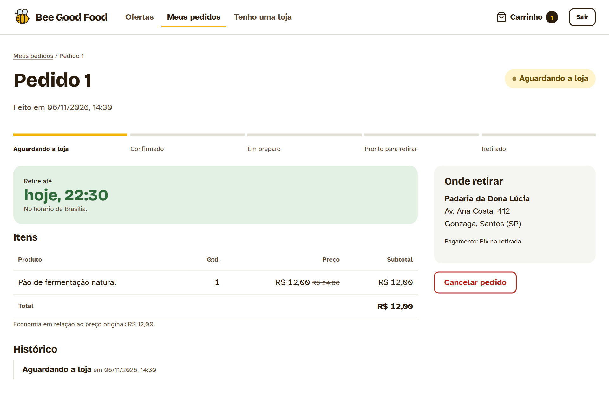 |
| **Carrinho:** um pedido é sempre de uma única loja, e o total final é calculado pela API. | **Pedido:** código de retirada para mostrar no balcão, etapas, prazo no fuso da loja e atualização automática. |
| 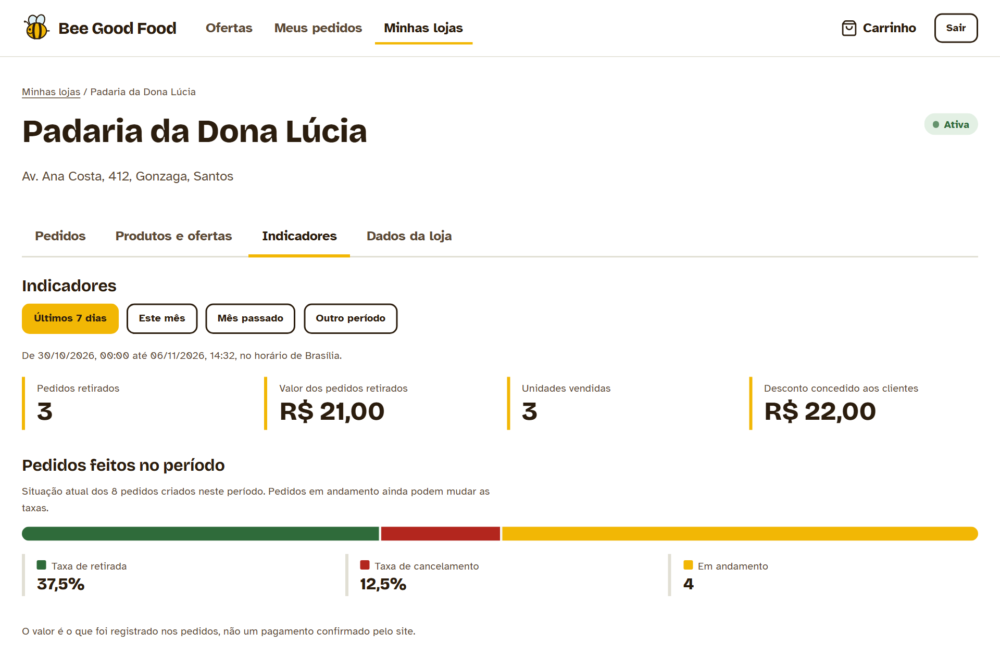 | 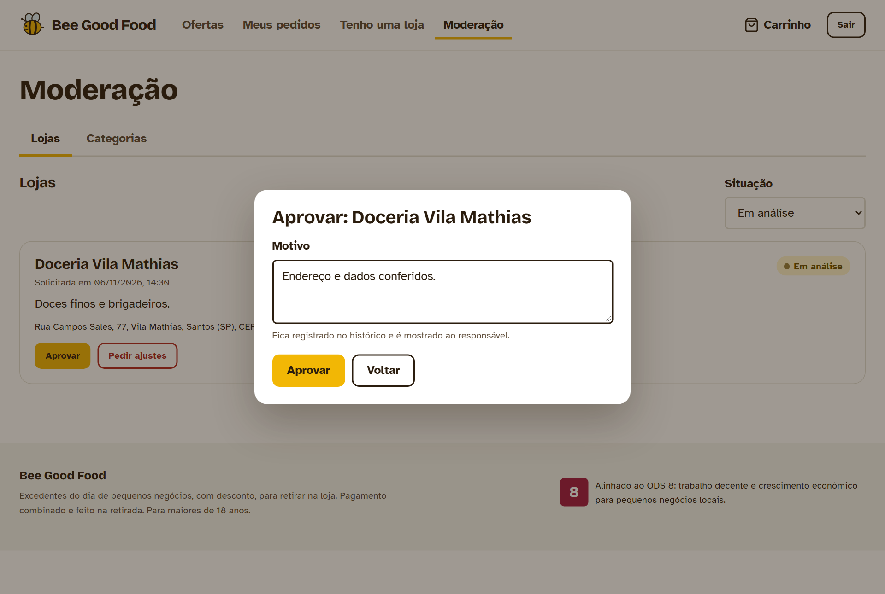 |
| **Indicadores:** pedidos retirados, valor, unidades e taxas da coorte do período. | **Moderação:** toda decisão exige motivo e fica no histórico da loja. |

<details>
<summary>Mais telas: tema escuro, fila de pedidos, gestão de ofertas e celular</summary>

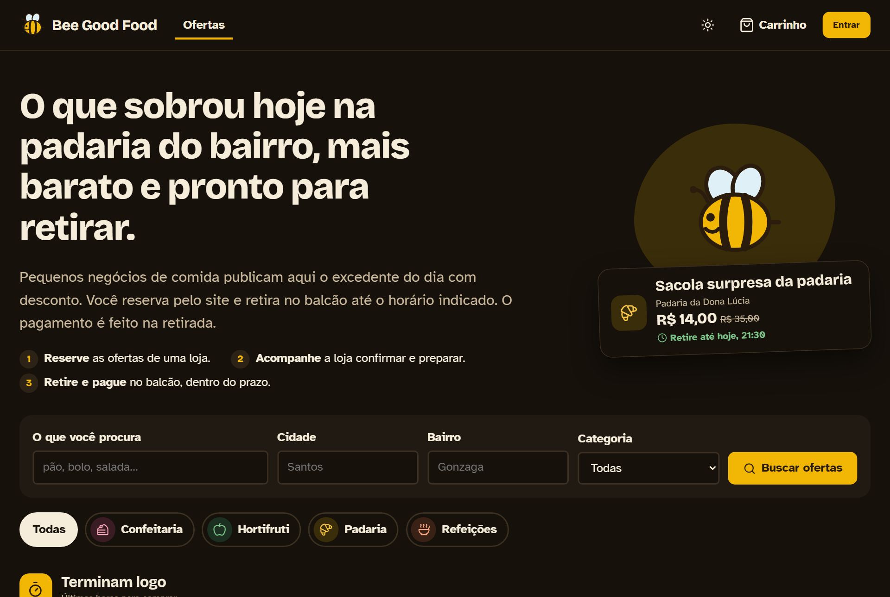
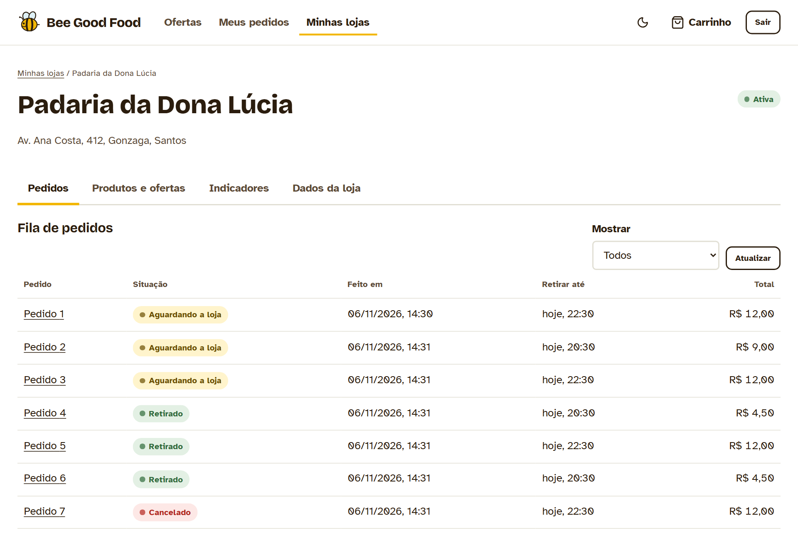
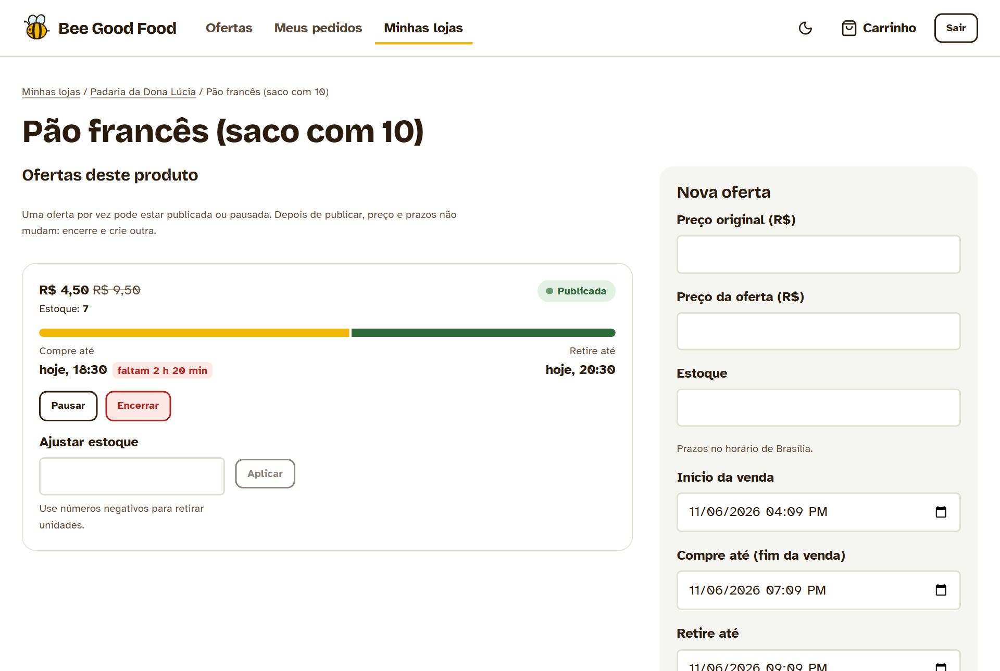
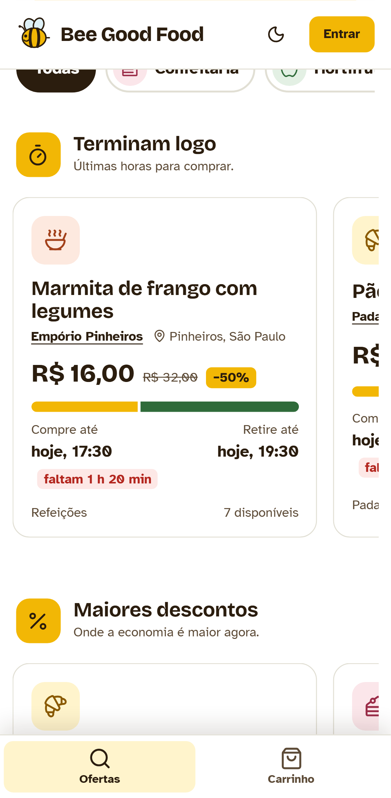

</details>

## Destaques técnicos

- **Pedido transacional e concorrente.** As ofertas são bloqueadas em ordem de ID e o estoque é descontado com atualização condicional. Testes com requisições simultâneas garantem que a última unidade gera um único pedido.
- **Idempotência.** Cada tentativa de reserva envia uma `Idempotency-Key`. Repetir a mesma compra devolve o pedido original sem descontar o estoque de novo; reutilizar a chave com outro conteúdo retorna `409`.
- **O servidor é a autoridade.** Preços, totais, prazo de retirada e o dono de cada recurso são definidos no backend. Recursos de outras pessoas respondem `404`, sem revelar que existem.
- **Datas e fusos.** O servidor e o banco trabalham em UTC, e os prazos aparecem no fuso IANA da loja. Durante o desenvolvimento, um teste revelou que o Hibernate gravava horários 3 horas adiantados. A correção veio junto com um teste de regressão.
- **Segurança.** JWT de 15 minutos guardado só em memória, BCrypt, papéis lidos do banco a cada requisição, limite de tentativas de login, CORS restrito a origens explícitas e suporte a proxy reverso configurável.
- **Regras também no banco.** Constraints `CHECK` e `UNIQUE` e uma coluna gerada garantem, por exemplo, uma única oferta ativa por produto, mesmo sob concorrência.
- **Decisões documentadas.** São 31 registros de decisão (DEC-001 a DEC-031), com motivo e consequência aceita, e 26 critérios de aceitação ligados aos testes.

## Arquitetura

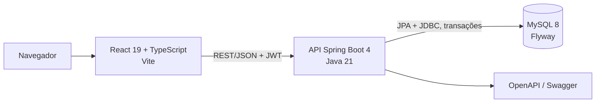

A API é um monólito modular, com um pacote por área: `auth`, `estabelecimentos`, `catalogo`, `pedidos` e `indicadores`. As entidades nunca saem da API: as respostas usam `record`s, e os erros seguem o padrão `ProblemDetail` (`application/problem+json`).

| Camada | Tecnologias |
|---|---|
| Frontend | React 19, TypeScript 5.9, Vite 8, React Router 7, lucide-react, Fontsource |
| Backend | Java 21, Spring Boot 4.1 (Web MVC, Security, Data JPA, Validation, Actuator), springdoc-openapi |
| Banco | MySQL 8, Flyway |
| Testes | JUnit 5, AssertJ, HTTP real contra MySQL, Vitest, Testing Library, Playwright, axe-core |

## Testes e qualidade

| Suíte | Quantidade | O que cobre |
|---|---|---|
| Backend HTTP/MySQL | 171 | Todos os endpoints contra um MySQL real: sucesso, validação, 401/403, recurso de outra pessoa, cenários simultâneos, ordenação da vitrine e remoção. |
| Backend unitários | 9 | Limite de tentativas, chave JWT e relógio com precisão de microssegundos. |
| Frontend unitários | 20 | Regras do carrinho, conversão de fusos, confirmação ao trocar de loja e a API simulada da demonstração. |
| Navegador (Playwright) | 15 | Fluxos de cliente, responsável e administração, no desktop e no celular, nos temas claro e escuro. |
| Acessibilidade (axe) | 17 telas | WCAG 2.1 A/AA, sem violações, inclusive no tema escuro. |

Os resultados de cada etapa estão registrados em [`backend/evidencias`](backend/evidencias). Os números acima vêm de [`validacao-vitrine-e-demo.json`](backend/evidencias/validacao-vitrine-e-demo.json). São resultados locais: não medem desempenho sob carga nem substituem testes com pessoas.

## Como executar localmente

Para só ver a interface, sem Java nem MySQL: `cd frontend; npm install; npm run dev:demo` abre a mesma demonstração da Vercel em `http://localhost:5173`.

Sistema completo. Pré-requisitos: JDK 21 ou superior, Node 20 ou superior e MySQL 8.

1. Crie um schema vazio e um usuário no MySQL. O passo a passo está em [`backend/README.md`](backend/README.md#executar-para-desenvolvimento).
2. Inicie a API. O Flyway cria as tabelas na primeira execução.

   ```powershell
   cd backend
   $env:DB_URL = 'jdbc:mysql://127.0.0.1:3306/bee_good_food?connectionTimeZone=UTC&forceConnectionTimeZoneToSession=true'
   $env:DB_USER = 'bee_app'
   $env:DB_PASSWORD = Read-Host 'Senha do MySQL' -MaskInput
   $b = [byte[]]::new(32); [Security.Cryptography.RandomNumberGenerator]::Fill($b)
   $env:JWT_SECRET_BASE64 = [Convert]::ToBase64String($b)
   .\mvnw.cmd spring-boot:run
   ```

3. Em outro terminal, inicie a interface e abra `http://localhost:5173`.

   ```powershell
   cd frontend
   npm install
   npm run dev
   ```

4. Opcional: crie um administrador pelo [procedimento documentado](docs/planejamento/autenticacao.md#administração-local-controlada) e rode `npm run demo:popular` para ter lojas e ofertas de exemplo.

A documentação interativa da API fica em `http://127.0.0.1:8080/swagger-ui/index.html`.

## Estrutura do repositório

```text
Bee_Good_Food_Recode/
├── backend/      # API Spring Boot, testes HTTP/MySQL e evidências
├── frontend/     # Interface React, testes unitários e Playwright, scripts de demonstração
├── database/     # Migrations Flyway (fonte única), seeds e verificações SQL
└── docs/         # Planejamento, decisões, critérios, guia de publicação e imagens
```

## Documentação

- [Escopo](docs/planejamento/escopo.md) e [requisitos](docs/planejamento/requisitos-iniciais.md)
- [Atendimento ao desafio](docs/planejamento/atendimento-ao-desafio.md)
- [Decisões do MVP e arquitetura](docs/planejamento/decisoes-do-mvp.md)
- [Análise de mercado e melhorias](docs/planejamento/analise-de-mercado.md)
- [Critérios de aceitação](docs/planejamento/criterios-de-aceitacao.md)
- [Modelo de dados](docs/planejamento/modelo-de-dados.md)
- [Métricas e validação](docs/planejamento/metricas-e-validacao.md)
- [Riscos e premissas](docs/planejamento/riscos-e-premissas.md)
- [API: execução, rotas e erros](backend/README.md)
- [Frontend: execução e estrutura](frontend/README.md)
- [Guia de publicação](docs/deploy.md)
- Conclusão de cada etapa: [2](docs/planejamento/conclusao-etapa-2.md), [3](docs/planejamento/conclusao-etapa-3.md), [4](docs/planejamento/conclusao-etapa-4.md), [5](docs/planejamento/conclusao-etapa-5.md), [6](docs/planejamento/conclusao-etapa-6.md), [7](docs/planejamento/conclusao-etapa-7.md)

## Andamento

- [x] Etapa 1: escopo, requisitos e migração seletiva do TCC
- [x] Etapa 2: modelagem MySQL e verificações SQL
- [x] Etapa 3: base da API, Flyway e OpenAPI
- [x] Etapa 4: cadastro adulto, JWT e perfis de acesso
- [x] Etapa 5: lojas, moderação, catálogo, busca, pedidos e indicadores
- [x] Etapa 6: interface React integrada
- [x] Etapa 7: parte técnica (testes no navegador, acessibilidade, CRUDs completos e demonstração publicada)
- [ ] Validação com pessoas (5 consumidores e 3 responsáveis por lojas)
- [ ] Apresentação final

Fora do escopo do MVP: entrega, pagamento online, geolocalização e refresh token. Todos os motivos estão nas [decisões](docs/planejamento/decisoes-do-mvp.md).

## Origem: TCC

O projeto nasceu como TCC, com protótipo em Next.js e uma pesquisa exploratória com 4 participantes. O Recode reaproveitou o fluxo de navegação e os aprendizados da pesquisa: deixar a proposta clara na página inicial, rever as cores e mostrar com clareza o prazo de cada produto. O código e a arquitetura foram refeitos do zero.

- [Repositório do TCC](https://github.com/SamuelMonsalvesMoreira/Bee_Good_Food_TCC)
- [Protótipo original publicado](https://v0-ifood-like-website.vercel.app/login)
- [Resumo da pesquisa original](docs/referencias-tcc/pesquisa-original-resumo.md)

## Autor

**Samuel Monsalves Moreira**: [github.com/SamuelMonsalvesMoreira](https://github.com/SamuelMonsalvesMoreira)

## Licença

[MIT](LICENSE).
