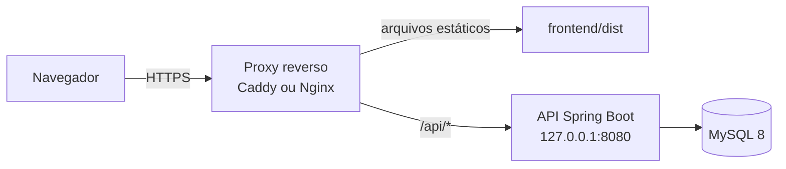

# Guia de publicação

Este guia descreve como publicar o Bee Good Food em um servidor próprio para demonstração. A demonstração só com interface foi publicada na Vercel em 09/11/2026. O **sistema completo** (API e MySQL) **não foi executado** em um ambiente público. Foram validados localmente o JAR, o build do frontend e a contagem de tentativas por cliente atrás de um proxy (teste automatizado com `X-Forwarded-For` no loopback). O exemplo de configuração do Caddy não foi executado.

## Demonstração do TCC: só Vercel (modo demonstração)

É o link do README. A interface é publicada sozinha, com a API simulada no navegador ([DEC-037](planejamento/decisoes-do-mvp.md)): abre na hora, não depende de servidor e não guarda dados de ninguém.

1. Em [vercel.com](https://vercel.com), entre com a conta do GitHub e clique em *Add New > Project*.
2. Importe o repositório `Bee_Good_Food_Recode`. Mantenha o nome sugerido, `bee-good-food-recode`, para o endereço ficar `https://bee-good-food-recode.vercel.app` (o mesmo do README). Se o nome estiver ocupado, use outro e atualize o link no README.
3. Em **Root Directory**, escolha `frontend`. O resto vem do `frontend/vercel.json` (`npm run build:demo`, saída `dist`). Não é preciso variável de ambiente.
4. Clique em *Deploy*. A cada push na `main`, a Vercel publica de novo.

Para conferir antes, sem publicar: `cd frontend; npm run build:demo; npx vite preview`.

**Situação atual:** publicada em [bee-good-food-recode.vercel.app](https://bee-good-food-recode.vercel.app) a partir da `main`. O projeto da Vercel ainda não está vinculado ao repositório, então um novo push não publica sozinho. Para isso, instale o [aplicativo da Vercel no GitHub](https://github.com/apps/vercel) e conecte o repositório em *Settings > Git*. O passo 4 acima só vale depois desse vínculo.

## Publicação gratuita: Vercel, Render e Aiven

Caminho pensado para uma demonstração de portfólio, sem custo. A interface fica no **Vercel**, a API no **Render** (Docker) e o MySQL na **Aiven**. O Vercel encaminha `/api` para o Render (`frontend/vercel.json`), então o site e a API ficam na mesma origem e não é preciso CORS.

> Limites dos planos gratuitos (conferir nos sites, podem mudar): a API do Render "dorme" após um período sem acesso e leva cerca de um minuto para acordar no primeiro acesso; o MySQL gratuito tem pouco espaço e conexões. Suficiente para demonstração, não para uso real.

### Passo a passo

1. **MySQL (Aiven).** Crie um serviço MySQL no plano gratuito. Na página do serviço, copie host, porta, usuário e senha. Monte a `DB_URL`:
   `jdbc:mysql://HOST:PORTA/defaultdb?sslMode=REQUIRED&connectionTimeZone=UTC&forceConnectionTimeZoneToSession=true`
2. **API (Render).** Em *New > Blueprint*, conecte este repositório: o `render.yaml` cria o serviço `bee-good-food-api` com o `backend/Dockerfile`. Preencha no painel:
   - `DB_URL`, `DB_USER`, `DB_PASSWORD`: os dados da Aiven;
   - `JWT_SECRET_BASE64`: 32 bytes aleatórios em Base64 (gere com o comando do `backend/README.md` e guarde num gerenciador de senhas).
   Aguarde o deploy e abra `https://<servico>.onrender.com/actuator/health`: deve mostrar `UP`. O Flyway cria as tabelas sozinho.
3. **Endereço da API no Vercel.** Se o Render der ao serviço um endereço diferente de `bee-good-food-api.onrender.com`, ajuste o `destination` em `frontend/vercel.json` e faça commit.
4. **Interface (Vercel).** Em *Add New > Project*, importe o repositório e defina **Root Directory = `frontend`**. Antes, troque `buildCommand` no `frontend/vercel.json` de `npm run build:demo` para `npm run build` e faça commit: o arquivo tem prioridade sobre o painel, e a build de demonstração liga a API simulada. Não é preciso variável de ambiente.
5. **Primeiro administrador.** Crie uma conta pelo site publicado e conceda `ADMINISTRADOR` pelo [procedimento controlado](planejamento/autenticacao.md#administração-local-controlada), conectando-se ao MySQL da Aiven.
6. **Dados de demonstração (opcional).** Na pasta `frontend`, com `BEE_API` apontando para a URL do Render e o administrador do passo 5, rode `npm run demo:popular`.
7. **Conferir.** Busque ofertas, faça uma reserva e entre como a loja. Depois coloque o link do site no README e na descrição do repositório.

A imagem Docker foi testada localmente com Java 21: saúde, migrations, cadastro, login e limite de tentativas por cliente atrás de proxy.

## Arquitetura recomendada



O proxy serve a interface e encaminha `/api` para a API **na mesma origem**. Assim não é preciso CORS. A API e o MySQL escutam só no loopback ou em rede privada; somente o proxy fica exposto.

## Pré-requisitos

- JDK 21 ou superior, Node 20 ou superior (só para gerar o build), MySQL 8.
- Domínio apontando para o servidor e certificado HTTPS. O Caddy obtém o certificado automaticamente.

## 1. Banco de dados

1. Crie um schema **novo** (`bee_good_food`) e um usuário limitado a ele, com senha forte. Veja `backend/README.md`.
2. O Flyway cria as tabelas na primeira inicialização da API. Não rode V1/V2 manualmente nem os seeds.

## 2. API

```powershell
cd backend
.\mvnw.cmd -B -DskipTests package   # gera target\bee-good-food-api-0.1.0-SNAPSHOT.jar
```

Variáveis de ambiente do serviço:

| Variável | Valor |
|---|---|
| `DB_URL` | `jdbc:mysql://127.0.0.1:3306/bee_good_food?connectionTimeZone=UTC&forceConnectionTimeZoneToSession=true` |
| `DB_USER` / `DB_PASSWORD` | Usuário limitado ao schema. |
| `JWT_SECRET_BASE64` | 32 bytes aleatórios em Base64, **fixos** entre reinícios e guardados num cofre de segredos. Trocar a chave encerra todas as sessões. |
| `SERVER_ADDRESS` / `SERVER_PORT` | `127.0.0.1` e `8080` (atrás do proxy). |
| `FORWARD_HEADERS_STRATEGY` | `native`: o limite de tentativas de login passa a contar por cliente real, e não pelo IP do proxy. |
| `TRUSTED_PROXIES` | Expressão regular com o IP do proxy. Padrão: só loopback (proxy na mesma máquina). |
| `CORS_ORIGINS` | Vazio quando o proxy serve tudo na mesma origem. Só preencha se o site ficar em outro domínio. |

Execute com `java -jar bee-good-food-api-0.1.0-SNAPSHOT.jar` como serviço do sistema (systemd, NSSM no Windows ou similar), reiniciando em caso de falha. Verifique `GET /actuator/health`.

> Só use `FORWARD_HEADERS_STRATEGY=native` se o proxy **sobrescrever** o cabeçalho `X-Forwarded-For` e a API não estiver acessível diretamente. Do contrário, um cliente poderia forjar o IP e escapar do limite de tentativas.

## 3. Interface

```powershell
cd frontend
npm ci
npm run build   # gera frontend\dist
```

Com proxy na mesma origem, deixe `VITE_API_URL` vazio. Copie `dist` para o servidor.

## 4. Proxy reverso (exemplo com Caddy)

```caddyfile
bee.exemplo.com.br {
    encode gzip
    handle /api/* {
        reverse_proxy 127.0.0.1:8080 {
            header_up X-Forwarded-For {remote_host}
        }
    }
    handle {
        root * /srv/bee-good-food/dist
        try_files {path} /index.html
        file_server
    }
    header {
        Strict-Transport-Security "max-age=31536000"
        X-Content-Type-Options "nosniff"
        Referrer-Policy "strict-origin-when-cross-origin"
    }
}
```

`try_files ... /index.html` é necessário porque a interface usa rotas no navegador (`/ofertas/12`, `/minhas-lojas/3`). Não exponha `/actuator` além de `health` (já é o padrão) nem a porta do MySQL.

## 5. Primeiro administrador

Não existe conta administrativa padrão. Crie uma conta pelo site e conceda `ADMINISTRADOR` pelo procedimento controlado de [autenticação](planejamento/autenticacao.md#administração-local-controlada), conferindo o ID antes.

## 6. Dados de demonstração (opcional, nunca em produção real)

Em um banco **só de demonstração**, com o administrador criado:

```powershell
cd frontend
$env:BEE_API = 'http://127.0.0.1:8080'
$env:BEE_ADMIN_EMAIL = 'admin@exemplo.invalid'
$env:BEE_ADMIN_SENHA = Read-Host 'Senha do administrador' -MaskInput
npm run demo:popular
```

As ofertas criadas valem por algumas horas. Rode de novo antes de cada apresentação.

## Checklist antes de abrir ao público

- [ ] HTTPS ativo e redirecionamento de HTTP para HTTPS.
- [ ] `JWT_SECRET_BASE64` aleatório, fixo e fora do Git; senhas do MySQL fortes e fora do Git.
- [ ] API e MySQL inacessíveis diretamente pela internet.
- [ ] `FORWARD_HEADERS_STRATEGY` e `TRUSTED_PROXIES` coerentes com o proxy real.
- [ ] Backups do MySQL agendados e testados.
- [ ] Runner oficial (`database/scripts/validar-banco.ps1 -Api`) executado com sucesso na versão publicada.
- [ ] Termos de uso e aviso de privacidade (LGPD) revisados: o sistema guarda nome, e-mail e pedidos.

## Limites conhecidos

- O limite de tentativas é em memória, por instância. Com mais de uma instância da API, cada uma conta separadamente.
- Não há recuperação de senha nem revogação imediata de token (DEC: sem refresh token no MVP).
- Logs vão para a saída padrão. Configure a retenção no serviço e não registre corpos de requisição.
